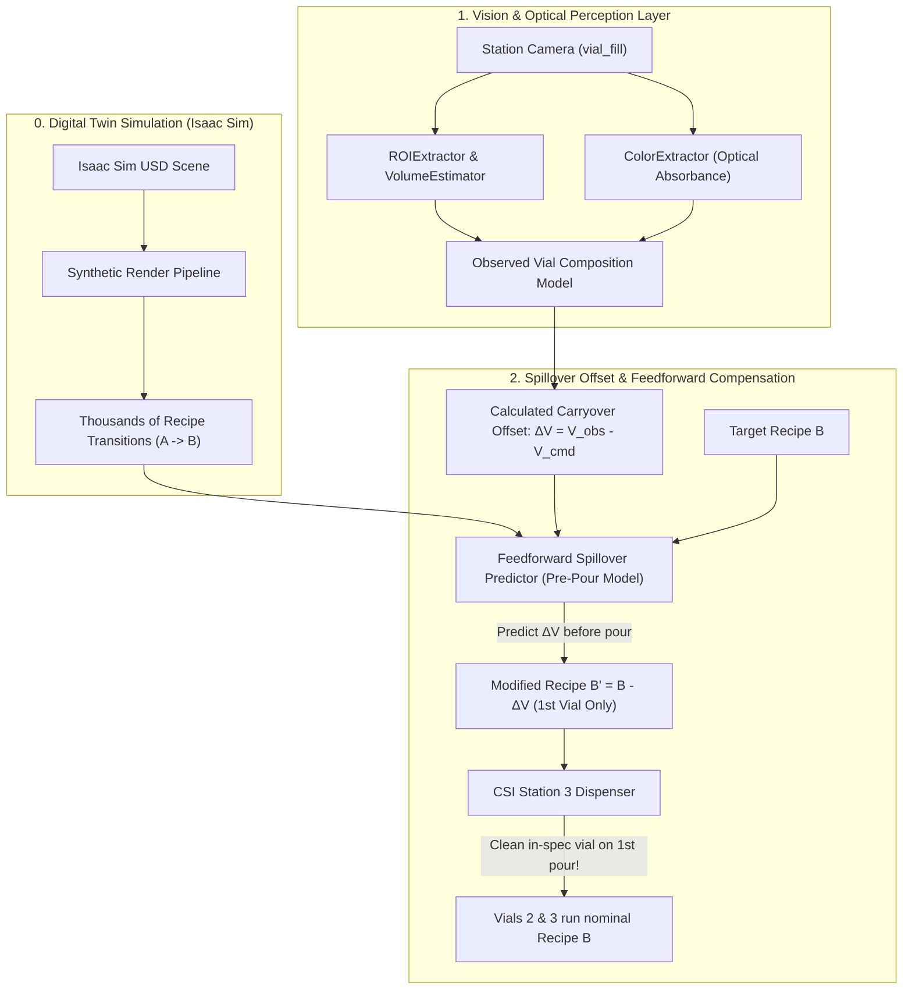

# Team Project Notes: Fluid Mixing Station 3 (Physical AI & Vision)

> **Challenge Track**: Fluid Mixing Station 3 (CSI Testbed)  
> **Core Mission**: Detect fill volume and color defects caused by recipe changeovers, and deliver automated root-cause diagnostics linking optical faults back to preceding recipe fluid carryover.

---

## ⚡ Quickstart (Run in 10 Seconds)

```powershell
# 1. Install dependencies
py -3.12 -m pip install -r requirements.txt

# 2. Download raw data files from Google Drive:
# https://drive.google.com/drive/folders/18vpLUhniZ-Rn73ThbKCS38WP6NFFBz23
# Place extracted contents into personal_data/ (which is in .gitignore so large MP4s are not tracked by git).

# 3. Run single-vial inspection demo (Vial 7 carryover defect vs Vial 9 clean)
py -3.12 examples/demo_single_vial.py --image "vial_fill_20260923_195325_659355.jpg" --recipe 7 --prev_recipe 6 --vial 7

# 4. Run/start the automated video tagger (generates tags for Videos 1-5):
python -m tagger.auto_tagger --video 1 --out-dir data/tags

# 5. Run full 30-vial ground-truth benchmark
py -3.12 examples/demo_batch_evaluation.py
```

> [!IMPORTANT]
> ### 🚨 Critical Data Directory Rules (`data/`)
> * **[`data/given_tags/`](file:///C:/Users/granta/ai-club/msoe-ai-club-rockwell-automation-nvidia-hackath-sydney-madden-s-team-83d2969bcc/data/given_tags/)**: Official ground-truth labels provided directly by the hackathon organizers. **CRITICAL: NEVER EDIT, OVERWRITE, OR MODIFY THESE FILES.**
> * **[`data/tags/`](file:///C:/Users/granta/ai-club/msoe-ai-club-rockwell-automation-nvidia-hackath-sydney-madden-s-team-83d2969bcc/data/tags/)**: Production tags generated automatically by the [`AutoTagger`](file:///C:/Users/granta/ai-club/msoe-ai-club-rockwell-automation-nvidia-hackath-sydney-madden-s-team-83d2969bcc/tagger/auto_tagger.py#L40) engine for Videos 1–5.
> * **Starting the Tagger / API**: Run `python -m tagger.auto_tagger --video <id> --out-dir data/tags` (or programmatically via `from tagger import AutoTagger; tagger = AutoTagger()`). See [`tagger/README.md`](file:///C:/Users/granta/ai-club/msoe-ai-club-rockwell-automation-nvidia-hackath-sydney-madden-s-team-83d2969bcc/tagger/README.md) for full API details.

---

## 🧠 Critical Technical Insights (Read Before Coding!)

1. **The Shared Nozzle Carryover Mechanism**:
   - Fluids from all tanks feed through a **single shared nozzle**.
   - When switching recipes, residual fluid from the previous recipe clings to the nozzle and contaminates the **first vial** of the new batch (e.g. Recipe 6 Orange carrying over into Recipe 7 Blue creates an out-of-spec **Green** in Vial 7).
   - **Vials 2 & 3 of every batch are steady-state clean** because the line naturally self-flushes after 1 vial.

2. **The 4 Reagent Tanks**:
   - **T-100**: Clear diluent (water)
   - **T-200**: Orange dye
   - **T-300**: *OUT OF SERVICE* (do not use in any recipe)
   - **T-400**: Blue dye
   - *Dispense Sequence*: Always T-200 -> T-400 -> T-100 (T-100 acts as an end-of-pour rinse).

3. **Camera Angle & Meniscus Perspective**:
   - The camera is angled downwards (~15-20 deg pitch), not perpendicular.
   - The meniscus is a **curved ellipse**, not a flat horizontal line.
   - Pixels-per-mL is **non-linear** due to perspective foreshortening (1 mL at the top has fewer pixels than 1 mL at the bottom). A 2nd-degree polynomial calibration is needed.

4. **Non-Linear Optical Absorption (Beer-Lambert Law)**:
   - Dyes do not mix linearly in RGB/Hue space.
   - Even a tiny trace (~1.5 mL) of Orange dye drastically shifts Blue into Green, masking the blue signature.
   - The model must map optical density / log-absorbance (A = -log10(I/I0)) rather than naive linear RGB to avoid wildly underestimating blue volume.

5. **Multi-Stage In-Fill Sampling (Why Vial Fill Stills Matter)**:
   - Contamination detection is not restricted to the finished vial.
   - Because fluids dispense sequentially ($T_{200} \rightarrow T_{400} \rightarrow T_{100}$), nozzle residue flushes out during the **very first component pour**.
   - Comparing the observed color and volume at intermediate stages against **what should have been poured up to that point in time** isolates the carryover before diluents mix in, giving a cleaner, higher-accuracy measurement.

---

## 🏗️ System Architecture & Closed-Loop Control



---

## 🎯 Final Goal: Pre-Pour Spillover Prediction & Recipe Modification ($B'$)

Our end-to-end goal goes beyond flagging defective vials after the fact—we want to **prevent defect waste entirely**:

1. **Calculate the Measured Offset (Post-Pour Vision)**:
   - Use our optical color model to calculate the exact offset of excess carryover fluid that entered the vial: $\Delta V = V_{\text{observed}} - V_{\text{commanded}}$.
2. **Train Pre-Pour Predictor on Large Trial Sets (Digital Twin)**:
   - Using a large dataset of transitions simulated in the Isaac Sim digital twin, train a machine learning model to predict the spillover **before** the vial is poured based on the previous recipe $A$ and the upcoming recipe $B$.
3. **Proactive Recipe Adjustment ($B'$)**:
   - **Applicable strictly to the first vial after switching recipes** (since Vials 2 & 3 are steady-state clean as the line naturally self-flushes).
   - Order modified recipe:
     $$B' = B - \Delta \hat{V}_{\text{carryover}}$$
   - When the station doses $B'$, the residual carryover in the nozzle combines with $B'$ to yield the exact intended fluid volume and color in the vial on the very first try!

---

## 🤖 Getting Data from the Isaac Sim Digital Twin

Physical line experiments are slow and costly. We use the **NVIDIA Isaac Sim digital twin** to generate large-scale training trials:
* **Download the USD Asset**: Download the digital twin from the [Innovation Lab data portal](https://msoe-maic.com/library?article=Rockwell-NVIDIA-Fall-2026-Fluid-Mixing) under `digital_twin/` (matches the `vial_fill` and `cap_seal` cameras).
* **Generating Synthetic Data**: Run the included Isaac Sim rendering script with varied dye volumes ($T_{100}, T_{200}, T_{400}$) and lighting conditions. Save output images and labels to `personal_data/synthetic/`.
* **Workflow**: Train the color unmixing and feedforward spillover predictor on the digital twin dataset, then validate on the physical line dataset (Video 5).

---

## 📋 System Milestones & Capabilities

- [x] **Working Baseline Established**: End-to-end vision, volume, color, composition, and diagnostic pipeline running on Python 3.12.
- [x] **Verified on Real Data**: Vial 7 (Green Carryover Defect) and Vial 9 (Clean Blue Pass) verified on physical line imagery.
- [x] **Vision & Volume Calibration**: Implemented calibrated 2nd-degree perspective polynomial curve ($V(px) = a \cdot px^2 + b \cdot px + c$) and pneumatic carriage clamp continuity correction in [`src/vision/volume_estimator.py`](file:///C:/Users/granta/ai-club/msoe-ai-club-rockwell-automation-nvidia-hackath-sydney-madden-s-team-83d2969bcc/src/vision/volume_estimator.py) and [`tagger/volume_estimator.py`](file:///C:/Users/granta/ai-club/msoe-ai-club-rockwell-automation-nvidia-hackath-sydney-madden-s-team-83d2969bcc/tagger/volume_estimator.py).
- [x] **Automated Video Tagging Engine**: Auto-tagging complete for Videos 1–5 (`data/tags/`). Video 5 benchmark achieves 100% exact match (30/30 vials, 78/78 pours).
- [ ] **Feedforward Spillover Predictor ($B'$)**: Use optical absorbance to calculate excess carryover offset, then train a model on Isaac Sim trials to predict spillover before pour and output modified recipe $B'$ for the first vial.
- [ ] **End-to-End Lab Deployment**: Integrate frontend interface, API server, and automated diagnostics engine.

---

# Rockwell Automation + NVIDIA Innovation Lab · Fall 2026

This is your team's repository for the four-week physical AI hackathon run by Rockwell Automation, NVIDIA, the MSOE AI Club and UWM's Connected Systems Institute. Build everything here. Sponsors can follow your work as it progresses, and your final submission links straight to this repository.

**Full event guide** (datasets, compute, rules, judging, prizes): <https://msoe-maic.com/library/?article=Rockwell-NVIDIA-Fall-2026>
**Your team workspace** (team, repository access, submissions): <https://dashboard.all-ai-network.org/j/L36HEH>
**Questions:** [join the hackathon Slack](https://join.slack.com/t/rockwellnvidi-wq82211/shared_invite/zt-4bp05nsn9-UW3afFtM9wjzWtZiQoJBHg) and ask in the channel that matches your question. The event guide's "Getting help" section says who to ping for what.

## Key dates

| When | What |
|---|---|
| Thu Oct 8, 4:00–6:00 PM | Kickoff at Rockwell Automation HQ, 1201 S 2nd St, Milwaukee |
| **Wed Oct 14, 11:59 PM CT** | **Team plan due:** [submit it here](https://dashboard.all-ai-network.org/s/V28NHK) |
| **Sun Nov 1, 11:59 PM CT** | **Final submission due:** [submit it here](https://dashboard.all-ai-network.org/s/V28NHK) |
| Thu Nov 5, 5:00–8:00 PM | Finals at MSOE Diercks Hall: live presentations and prizes |

## First week

- [ ] Everyone on the team has an ALL AI Network account and has joined this team in the [workspace](https://dashboard.all-ai-network.org/j/L36HEH).
- [ ] Everyone has connected GitHub and accepted the repository invitation (check your GitHub email, or open the workspace and press the check button).
- [ ] Pick your dataset. We recommend one strong solution around a single dataset.
- [ ] Download the data and make sure everyone who needs it can open it.
- [ ] Read the compute guide and decide what you'll need.
- [ ] Join Slack, open `#hackathon-announcements`, and find your dataset's channel.
- [ ] Submit the [team plan](https://dashboard.all-ai-network.org/s/V28NHK) by Wednesday, October 14. It's a short resource request, not a graded paper, and any teammate can update it before the deadline.

## The three datasets

1. **[Final Vial Inspection](https://msoe-maic.com/library?article=Rockwell-NVIDIA-Fall-2026-Vial-Inspection):** find missing caps, crooked caps, damaged vials and unexpected empty positions after the robot fills a fixture.
2. **[Fluid Mixing Station 3](https://msoe-maic.com/library?article=Rockwell-NVIDIA-Fall-2026-Fluid-Mixing):** use synchronized camera views to detect fill and color problems caused by recipes and fluid carryover.
3. **[Grasping and Sorting](https://msoe-maic.com/library?article=Rockwell-NVIDIA-Fall-2026-Grasping-Sorting):** use a digital twin and multiple cameras to make a standalone FANUC arm grasp and sort objects more reliably.

## Read before your team plan

- **[Compute: Brev, DGX Spark and build.nvidia.com](https://msoe-maic.com/library?article=Rockwell-NVIDIA-Fall-2026-Compute).** Brev credits are spent whenever an instance is running, so stop instances you aren't using.
- **[Collect and test your own data](https://msoe-maic.com/library?article=Rockwell-NVIDIA-Fall-2026-Data-Collection):** visits, extra data, digital twins, and booking a supervised test on the real equipment.
- **[Tools and resources](https://msoe-maic.com/library?article=Rockwell-NVIDIA-Fall-2026-Resources):** AI coding tools, vision-language models, NVIDIA Cosmos and more. Start with a simple baseline.

## Final submission (Sun Nov 1)

- A video of about five minutes
- A one-page project summary
- A link to this repository
- References and credits for data, models, code and tools

## Working in this repository

```bash
git clone <this repository's URL from the green "Code" button>
```

- Commit early and push often. Mentors and judges see what's here.
- **Don't commit large datasets or model weights.** Keep them out with `.gitignore` and note in this README where to download them.
- Before the finals, replace this README with your project: the problem, your approach, results, how to run it, and credits.

**Can't push or see this repository?** Open the [team workspace](https://dashboard.all-ai-network.org/j/L36HEH) and press the GitHub check button. If it still doesn't work, ping Brett Storoe in `#hackathon-general` on Slack.
