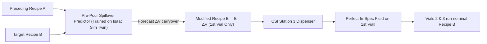

# Fluid Mixing Station 3: Team Development Guide & Roadmap
**Rockwell Automation + NVIDIA Hackathon · Fall 2026**

Welcome to the team codebase! This guide is designed so that anyone on the team can jump in, run tests immediately, and know exactly what to build.

---

## ⚡ 1. Quick Setup (1 Minute)

Ensure you have **Python 3.11 or 3.12** installed:
```powershell
# 1. Install dependencies
py -3.12 -m pip install -r requirements.txt
```

### Download & Setup Data
Download the raw data files from Google Drive:
👉 [**Google Drive Data Folder**](https://drive.google.com/drive/folders/18vpLUhniZ-Rn73ThbKCS38WP6NFFBz23)

* Copy the downloaded files into `personal_data/`.
* `personal_data/` is in `.gitignore`, keeping large MP4 video files and extracted stills out of git tracking.
* **Note on labels**: You do not need to copy any labels folder from Drive because ground-truth labels are already tracked in `data/tags/`.

### Try the 1-Click Demos
```powershell
# Inspect single vial (Vial 7 carryover vs clean Vial 9)
py -3.12 examples/demo_single_vial.py --image "vial_fill_20260923_195325_659355.jpg" --recipe 7 --prev_recipe 6 --vial 7

# Benchmark all 30 vials in Video 5
py -3.12 examples/demo_batch_evaluation.py
```
*Visual inspection overlays with bounding boxes, meniscus indicators, and diagnostic banners are saved to `output/`.*

---

## 🎯 2. Our Ultimate Project Goal: Pre-Pour Spillover Compensation ($B'$)

Our mission goes beyond detecting faults after a vial is already spoiled. We want **proactive feedforward compensation**:



1. **Calculate the Measured Offset (Post-Pour Vision)**:
   - Use our optical color and volume model to determine the exact volume offset of residual fluid that entered the vial: $\Delta V = V_{\text{observed}} - V_{\text{commanded}}$.
2. **Train Spillover Predictor on Large Trial Sets (Digital Twin)**:
   - Using a large dataset of transitions simulated in the Isaac Sim digital twin, train a model to predict spillover **before** the vial is poured based on the previous recipe $A$ and the upcoming recipe $B$.
3. **Proactive Recipe Adjustment ($B'$)**:
   - **Applicable strictly to the first vial after switching recipes** (since Vials 2 & 3 are steady-state clean as the line naturally self-flushes).
   - Order modified recipe:
     $$B' = B - \Delta \hat{V}_{\text{carryover}}$$
   - When the station doses $B'$, the residual carryover in the nozzle combines with $B'$ to yield the exact intended fluid volume and color in the vial on the very first try!

---

## 🤖 3. Getting & Using Data from the Isaac Sim Digital Twin

Physical line runs are limited and expensive. The hackathon's core guidance is: **Look at the real data, but train on the digital twin.**

* **Where to Download**: The USD digital twin asset is available from the hackathon data portal: [Innovation Lab Data Folder](https://msoe-maic.com/library?article=Rockwell-NVIDIA-Fall-2026-Fluid-Mixing) under `digital_twin/`. It contains the Station 3 USD model with cameras pre-calibrated to match `vial_fill` and `cap_seal`.
* **How to Generate Data**:
  1. Open Isaac Sim and load the station scene USD.
  2. Run the provided rendering script to simulate pours with randomized dye combinations, fill levels, and lighting variations.
  3. Save synthetic images and ground-truth metadata to `personal_data/synthetic/`.
* **Training Pipeline**:
  - Train the color unmixing model and the feedforward spillover predictor on thousands of synthetic digital twin transitions.
  - Validate the trained model directly against the physical line dataset (Video 5).

---

## 📁 4. Codebase Architecture

```
├── examples/
│   ├── demo_single_vial.py          # 1-click single frame inspection & visual overlay
│   └── demo_batch_evaluation.py     # Full 30-vial benchmark table
├── personal_data/
│   ├── images/                      # Extracted frame stills from CSI line
│   ├── labels/                      # Ground truth CSV labels (video5_vial_recipes.csv, etc.)
│   ├── videos/                      # MP4 recordings (vial_fill_video_1..5.mp4)
│   ├── synthetic/                   # Rendered images from Isaac Sim digital twin
│   └── image_index.csv              # Master mapping of filename -> timestamp -> video_id
├── src/
│   ├── config.py                    # ROIs, camera dimensions, tank colors, recipe definitions
│   ├── vision/
│   │   ├── roi.py                   # Cropping and visual bounding box overlays
│   │   ├── volume_estimator.py      # Meniscus edge detection & mL volume estimation
│   │   └── color_extractor.py       # Fluid sampling & optical absorbance (Beer-Lambert)
│   ├── models/
│   │   └── composition_model.py     # Inverse Recipe Regressor & Feedforward B' Predictor
│   ├── diagnostics/
│   │   └── root_cause.py            # Defect diagnosis & recipe history cross-referencing
│   └── data/
│       └── auto_labeler.py          # Auto-labeler for unlabelled Videos 1-4
└── output/                          # Generated debug overlays and inspection images
```

---

## 👥 5. Subteam Roles & Next Steps

### Subteam A: Computer Vision & Fill Tracking (2 People)
* **Core Files**: `src/vision/volume_estimator.py`, `src/vision/roi.py`
* **Key Tasks**:
  1. **Camera Angle & Meniscus Geometry**: The camera is angled downwards (~15–20°), meaning the meniscus projects as a curved ellipse, and perspective foreshortening makes pixel-to-mL scaling non-linear.
  2. **Polynomial Calibration**: Replace the linear slope in `volume_estimator.py` with a 2nd-degree polynomial calibration curve ($\text{Volume} = a \cdot y^2 + b \cdot y + c$) fit against known ground-truth fills.
  3. **Multi-Stage Pour Tracking**: Detect the pause between the first and second component pour (where ~90% of carryover enters before diluents mix in).
* **Test Command**: `py -3.12 -m src.vision.volume_estimator`

---

### Subteam B: Colorimetry & Feedforward Spillover Model (2 People)
* **Core Files**: `src/vision/color_extractor.py`, `src/models/composition_model.py`
* **Key Tasks**:
  1. **Optical Absorbance (Beer-Lambert)**: Dyes combine subtractively in transmitted light. Convert pixel intensities to optical absorbance ($A = -\log_{10}(I/I_0)$), where dye contributions add linearly.
  2. **Offset Calculation**: Calculate the physical offset $\Delta V$ of excess fluid that entered the vial.
  3. **Feedforward Spillover Predictor ($B'$)**: Train a model on Isaac Sim digital twin trials to predict $\Delta \hat{V}$ *before* the pour, outputting the modified recipe $B' = B - \Delta \hat{V}$ for the first vial.
* **Test Command**: `py -3.12 -m src.models.composition_model`

---

### Subteam C: Digital Twin Data, Diagnostics & Video (3 People)
* **Core Files**: `src/diagnostics/root_cause.py`, `src/data/auto_labeler.py`, `examples/`
* **Key Tasks**:
  1. **Digital Twin Data Generation**: Run the Isaac Sim script to generate synthetic transition trials with varied recipes and lighting.
  2. **Auto-Label Videos 1–4**: Update `src/data/auto_labeler.py` using temporal frame differencing in `NOZZLE_ROI` to auto-generate labels for unlabelled Videos 1–4.
  3. **Integrate `tank_level` Camera**: Check supply tank levels to distinguish empty supply barrels from nozzle carryover faults.
  4. **5-Minute Presentation Video**: Script and edit the final video showcasing the problem, vision pipeline, digital twin synthetic data, and the live $B'$ feedforward demo.
* **Test Command**: `py -3.12 examples/demo_batch_evaluation.py`

---

## 🛠️ 6. Running Automated Checks
Before submitting or pushing code, verify everything runs cleanly:
```powershell
py -3.12 -m src.vision.roi
py -3.12 -m src.vision.volume_estimator
py -3.12 -m src.vision.color_extractor
py -3.12 -m src.models.composition_model
py -3.12 examples/demo_single_vial.py
py -3.12 examples/demo_batch_evaluation.py
```
