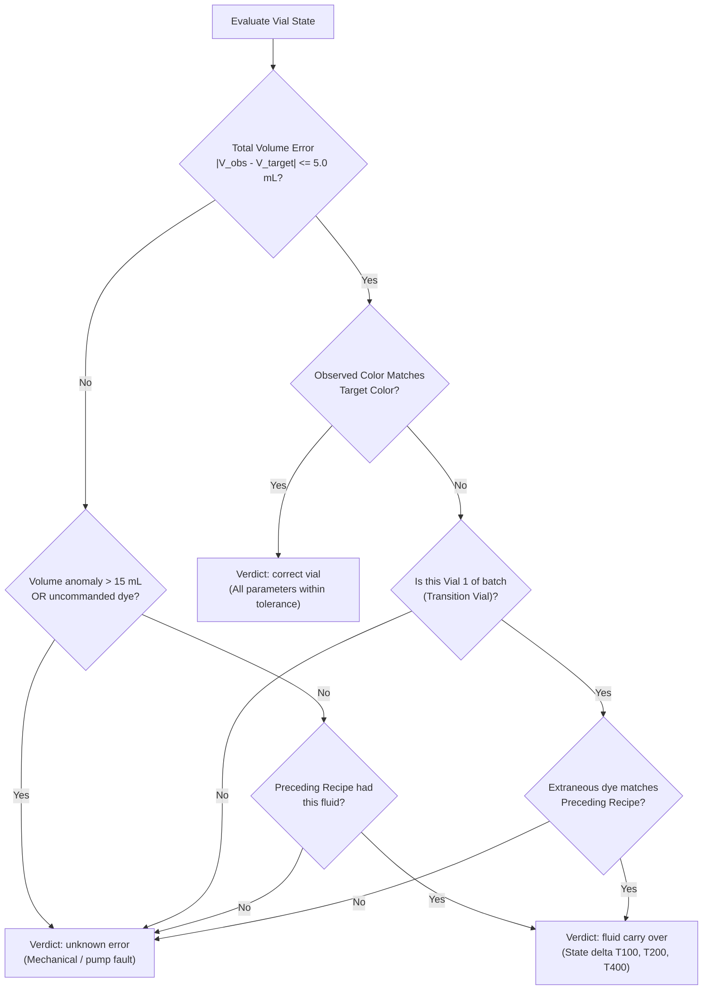

# Fluid Mixing Station: End-to-End System Design & Lab Deployment Specification

**Project**: Rockwell Automation + NVIDIA Innovation Lab (Fall 2026)  
**System**: Mixing Station Automated Video Tagger, Physical AI Inspection API & Frontend Dashboard  
**Status**: Pre-Lab Deployment Architecture Specification  

---

## 1. Executive Summary & Core Mission

This specification details the end-to-end software architecture for Fluid Mixing Station 3 prior to physical deployment and testing in the Connected Systems Institute (CSI) testbed. The system solves the **nozzle carryover defect challenge** in high-mix automated liquid packaging. 

### Core Operational Workflow
1. **Frontend**: Accepts uploaded Station 3 video recordings (`.mp4`), tracks real-time progress, and displays diagnostic results across all recipes.
2. **API Backend**: Coordinates video staging, launches the zero-lookup computer vision `AutoTagger`, identifies crucial post-pour settling timestamps, executes optical colorimetry and Model 1 inference, and runs the root-cause decision engine.
3. **Decision Engine**: Cross-references synthesizable tag fluid volumes with optical inferences against recipe sequence history to classify each vial into one of three distinct verdicts:
   * **`correct vial`**: Within specification.
   * **`fluid carry over`**: Contamination from preceding recipe fluid clinging to shared nozzle manifold (includes exact per-tank excess volumes $\Delta V_{100}, \Delta V_{200}, \Delta V_{400}$).
   * **`unknown error`**: Anomalies unexplainable by physical carryover (e.g. pump starvation, mechanical leakage, uncommanded reagent dosing).
4. **Compressed Results Payload**: Emits a structured JSON payload organized sequentially by recipe with per-vial metrics.

---

## 2. End-to-End System Architecture

```mermaid
flowchart TD
    User["Operator / Lab Tech"] -->|Uploads MP4 video| Frontend["Frontend UI (frontend/)"]
    Frontend -->|POST /api/v1/inspect/video| API["FastAPI Backend (api/main.py)"]
    
    subgraph Pipeline ["Processing Pipeline"]
        API -->|1. Stage video file| Staging["Staging Workspace (staging/<job_id>/)"]
        Staging -->|2. Frame extraction & stream profiling| AutoTagger["AutoTagger (tagger/auto_tagger.py)"]
        AutoTagger -->|3. Discrete pour windows & burst timings| PourTracker["Pour Event Profiler"]
        PourTracker -->|4. Crucial sample point selection| Sampler["Crucial Frame Extractor\n(Post-settle, pre-depart)"]
        
        Sampler -->|5. End-of-stream corridor crop| StreamColor["End-of-Stream Chromaticity Analyzer"]
        Sampler -->|6. Vial core crop (350x110)| Model1["Model 1 Composition Estimator\n(ai/model1.joblib)"]
        AutoTagger -->|7. Meniscus pixel counting| VolumeEngine["Volume Estimator\n(2nd-degree poly: V = a*px^2 + b*px + c)"]
        
        VolumeEngine & Model1 & StreamColor -->|8. Parallel vectors: V_tags & V_model| Fusion["Dual State Vector Synthesizer"]
        Fusion -->|9. Preceding recipe cross-check| DecisionEngine["Root Cause & Decision Engine"]
        DecisionEngine -->|10. Classify: Correct / Carryover / Unknown| ResultBuilder["Compressed JSON Formatter"]
    end
    
    ResultBuilder -->|HTTP 200 JSON Payload| Frontend
    Frontend -->|Renders batch summary, vial cards, defect flags| User
```

---

## 3. Component Specifications

### 3.1 Frontend Web Interface (`frontend/`)

#### A. Repository Placement & Directory Layout
Place the visually designed frontend into the `frontend/` directory at the project root:

```
msoe-ai-club-rockwell-automation-nvidia-hackath-sydney-madden-s-team-83d2969bcc/
├── frontend/                     # Frontend web application
│   ├── package.json              # Node dependencies (React, Vite/Next, Tailwind, Lucide)
│   ├── vite.config.js            # Build config with backend proxy (/api -> http://localhost:8000)
│   ├── index.html                # Single-page HTML shell
│   ├── src/
│   │   ├── App.jsx               # Main application container
│   │   ├── components/
│   │   │   ├── VideoUploader.jsx # Drag-and-drop video file input with progress bar
│   │   │   ├── RecipeGroup.jsx   # Accordion group displaying recipe targets
│   │   │   ├── VialCard.jsx      # Individual vial status badge, volume, color badge
│   │   │   ├── CarryoverBar.jsx  # 3-bar Delta V visualizer (T100, T200, T400)
│   │   │   └── DiagnosticModal.jsx # Detailed inspection overlay image & root-cause details
│   │   └── api/
│   │       └── client.js         # Axios / Fetch client calling backend endpoints
│   └── public/                   # Static assets, branding logos
```

#### B. Frontend Setup & Run Commands
```bash
# 1. Navigate to frontend directory and install dependencies
cd frontend
npm install

# 2. Start local development server
npm run dev
# Running on http://localhost:5173 (proxied to API on :8000)
```

#### C. Backend API Integration & Proxying
In `frontend/vite.config.js`:
```javascript
export default defineConfig({
  server: {
    port: 5173,
    proxy: {
      '/api': {
        target: 'http://localhost:8000',
        changeOrigin: true,
      },
    },
  },
});
```

---

### 3.2 FastAPI Backend Service (`api/`)

#### A. Directory Layout
```
├── api/
│   ├── __init__.py
│   ├── main.py              # FastAPI app definition, CORS, exception handlers
│   ├── routes.py            # API endpoints: POST /inspect/video, GET /jobs/{id}
│   ├── service.py           # Orchestration service running tagger + model1 + diagnostics
│   └── schemas.py           # Pydantic models for requests and compressed JSON response
```

#### B. Command to Start the API Server
```powershell
# Start the FastAPI server on port 8000
python -m uvicorn api.main:app --host 0.0.0.0 --port 8000 --reload
```

#### C. Video Ingestion & Dynamic Output Configuration
The API endpoint accepts a `multipart/form-data` upload:
```python
@router.post("/inspect/video", response_model=InspectionResponse)
async def inspect_video(file: UploadFile = File(...)):
    job_id = str(uuid.uuid4())[:8]
    staging_dir = Path("staging") / job_id
    staging_dir.mkdir(parents=True, exist_ok=True)
    video_path = staging_dir / file.filename

    with open(video_path, "wb") as buffer:
        shutil.copyfileobj(file.file, buffer)

    # Launch pipeline
    return run_inspection_pipeline(video_path, job_id, staging_dir)
```

#### D. Dynamic Tagger Invocation
`tagger/auto_tagger.py` is extended with a dynamic runner:
```python
def process_uploaded_video(
    video_path: Path,
    output_prefix: str,
    out_dir: Path,
) -> Dict[str, Any]:
    """Processes an uploaded MP4 directly without depending on personal_data/image_index.csv.
    
    Generates:
      - {output_prefix}_frame_labels.csv
      - {output_prefix}_tank_pours.csv
      - {output_prefix}_vial_recipes.csv
    """
```

---

### 3.3 Recipe Tank Order & Optical Colorimetry

#### The Physical Challenge
1. **Manifold Contamination at Burst Start**: In the first 0.3s of a dispense, fluid clinging to the nozzle tip mixes into the initial stream burst.
2. **Backlight Refraction & Bubble Noise**: The nozzle stream is fast-moving, narrow, and backlit, making raw RGB readings noisy.

#### The Dual-Verification Solution
To achieve 100% accurate tank ordering (`T100`, `T200`, `T400`), we fuse **End-of-Stream Chromaticity** with **Model 1 Vial Fluid Differential Tracking**:

```
[Dispense Stream Event]
      │
      ├───────────────────────────────────┬────────────────────────────────────┐
      ▼                                   ▼                                    ▼
[Leading Edge: 0.0s - 0.4s]    [Core Steady Flow: 0.4s - End-0.4s]   [End-of-Stream: Final 25%]
(CONTAMINATED NOZZLE TIP)      (HIGH VELOCITY / BUBBLES)             (STEADY, PURE UNMIXED FLUID)
      │                                   │                                    │
    DISCARD                             DISCARD                          SAMPLE CHROMATICITY:
                                                                         y in [110, 140], x in [306, 316]
                                                                         R-norm, B-norm, Hue
                                                                               │
                                                                               ▼
                                                                     Stream Tank ID Candidate
                                                                               │
                                                                               ▼
                                                                [FUSION WITH MODEL 1 VIAL DELTA]
                                                                               │
                                                                               ▼
                                                                   Final Confirmed Tank ID
```

1. **End-of-Stream Corridor Isolation**:
   * Sample strictly during the final 25% of the burst duration:
     $$t_{\text{sample}} \in [t_{\text{end}} - 0.7\text{s}, t_{\text{end}} - 0.2\text{s}]$$
   * Crop nozzle stream corridor ($y \in [110, 140], x \in [306, 316]$).
   * Evaluate chromaticity:
     * **T200 (Orange)**: $\frac{R}{R+G+B} > 0.42$ and $\frac{B}{R+G+B} < 0.22$
     * **T400 (Blue)**: $\frac{B}{R+G+B} > 0.45$ and $\frac{R}{R+G+B} < 0.20$
     * **T100 (Clear)**: Low saturation ($S < 25$) and $|R - B| < 12$
2. **Model 1 Differential Tracking on the Settled Vial**:
   * Crop the liquid core of the vial ($y \in [150, 410], x \in [275, 365]$) and resize to $350 \times 110$.
   * Feed to `Model 1` (`ai/model1.joblib`) to estimate ingredient volume fractions $\vec{f}_k = [f_{100}, f_{200}, f_{400}]_k$.
   * Multiply by continuous volume $V_k$ from the polynomial meniscus estimator:
     $$\vec{V}_k = V_k \cdot \vec{f}_k$$
   * Calculate incremental pour contribution:
     $$\Delta \vec{V}_k = \vec{V}_k - \vec{V}_{k-1} = [\Delta V_{100}, \Delta V_{200}, \Delta V_{400}]$$
   * The tank with the maximum positive delta confirms the active tank.

---

### 3.4 Crucial Sampling Point Determination

Timing is critical. Taking an optical sample too early catches turbulent surface ripples and bubbles; taking it too late risks the vial being unclamped and moved out of frame by the conveyor cart.

```
Pour Active [t_start ... t_end]
      │
      ▼
Pour Finished at t_end
      │
      ├───────────────────────────────┬───────────────────────────────┐
      │                               │                               │
[t_end to t_end + 1.0s]     [t_end + 1.2s to + 1.8s]        [t_end + 2.5s ... onward]
Surface ripples & foam      ★ CRUCIAL SAMPLING POINT ★     Next pour starts OR cart departs!
(DO NOT SAMPLE)             - Meniscus settled & flat       (TOO LATE)
                            - Bubbles fully popped
                            - Carriage clamp firmly closed
```

#### Sampling Rules
1. **Intermediate Pours ($k < N$)**:
   $$t_{\text{crucial}, k} = t_{\text{end}, k} + 1.5\text{s}$$
   * Guaranteed to be before next pour starts ($t_{\text{start}, k+1} - t_{\text{end}, k} \ge 3.5\text{s}$).
2. **Final Pour ($k = N$)**:
   The vial departure time $v_e$ is identified by conveyor optical flow ($\bar{dx} \le -1.2\text{ px/frame}$). The clamp releases $\sim 0.5\text{s}$ prior to motion.
   $$t_{\text{crucial}, \text{final}} = \min(t_{\text{end}, N} + 1.5\text{s}, v_e - 0.8\text{s})$$
   * Ensures the sample is captured while fluid is stationary and the vial is locked in the stationary station ROI.

---

### 3.5 Parallel Volume Tracking Vectors

For every vial, the API tracks two independent, parallel feature representations:

| Feature Dimension | $\vec{V}_{\text{tags}}$ (Synthesized from Tagger) | $\vec{V}_{\text{model}}$ (Inferred from Model 1 & Vision) |
| :--- | :--- | :--- |
| **Origin** | Discrete stream burst durations + pump flow dynamics + meniscus delta | Model 1 neural estimator + 2nd-degree perspective meniscus model |
| **Formula** | $V_k = Q_{\text{tank}} \cdot (t_{\text{end}} - t_{\text{start}} - t_{\text{delay}})$ | $\vec{V} = V_{\text{meniscus}} \cdot \vec{f}_{\text{model1}}$ |
| **Resolution** | Discrete volumetric chunks (e.g. 10 mL, 20 mL, 50 mL) | Continuous sub-milliliter resolution (e.g. 7.7 mL, 18.3 mL) |
| **Strengths** | 100% immune to color blending ambiguity | Highly sensitive to small contaminant traces (< 2 mL) |

---

### 3.6 Final Decision Engine (3 Verdicts)

The diagnostic engine evaluates the parallel vectors against target recipe $R_{\text{target}}$ and preceding recipe $R_{\text{prev}}$:



#### Detailed Verdict Specifications
1. **`correct vial`**:
   * Volume within tolerance: $|V_{\text{observed}} - V_{\text{target}}| \le 5.0\text{ mL}$.
   * Color classification matches nominal target color.
   * Extraneous reagent volume $< 2.0\text{ mL}$ across uncommanded tanks.
2. **`fluid carry over`**:
   * Triggered on Vial 1 of a new recipe.
   * Extraneous dye detected ($\ge 2.5\text{ mL}$) that was actively dispensed in $R_{\text{prev}}$ (e.g. Recipe 6 Orange carrying into Recipe 7 Blue to produce Green).
   * Required output fields:
     * `t100_delta_ml`: $V_{100, \text{observed}} - V_{100, \text{target}}$
     * `t200_delta_ml`: $V_{200, \text{observed}} - V_{200, \text{target}}$
     * `t400_delta_ml`: $V_{400, \text{observed}} - V_{400, \text{target}}$
3. **`unknown error`**:
   * Triggered when a defect cannot be explained by nozzle carryover:
     * Unexpected dye present that was **NOT** in the previous recipe.
     * Severe pump starvation / line blockage (underfill $> 15\text{ mL}$).
     * Color defect on steady-state clean vials (Vials 2 or 3 of a batch, where self-flushing was already complete).

---

## 4. Compressed JSON Output Blob Schema

The API returns a compact, structured JSON response organized sequentially by recipe:

### 4.1 Schema Definition
```typescript
interface InspectionResponse {
  job_id: string;                      // Unique inspection execution UUID
  video_filename: string;              // Uploaded MP4 filename
  processed_at: string;                // ISO 8601 timestamp
  summary: {
    total_recipes: number;             // Total distinct recipes executed
    total_vials: number;               // Total vials inspected
    total_pours: number;               // Total discrete stream bursts detected
    correct_vials: number;             // Count of "correct vial"
    carryover_defects: number;         // Count of "fluid carry over"
    unknown_errors: number;            // Count of "unknown error"
  };
  recipes: RecipeGroup[];              // Ordered sequence of recipes
}

interface RecipeGroup {
  recipe_id: number | string;          // Recipe identifier (e.g. 5, 6, 7 or "syn_triple")
  recipe_name: string;                // Human-readable recipe name
  nominal_targets: {
    t100_ml: number;                   // Commanded clear diluent mL
    t200_ml: number;                   // Commanded orange dye mL
    t400_ml: number;                   // Commanded blue dye mL
    total_ml: number;                  // Commanded total volume mL
    target_color: string;              // Expected color (e.g. "blue", "orange", "mixed green")
    dispense_order: string;            // Standard sequence (e.g. "T200>T400>T100")
  };
  results: VialResult[];               // Array of individual vial inspection results in order
}

interface VialResult {
  vial_id: number;                     // Sequence index of the vial (1, 2, 3...)
  batch_position: number;              // 1 = transition vial, 2 & 3 = steady-state clean
  timestamps: {
    station_enter_s: number;           // Arrival timestamp in station
    station_exit_s: number;            // Departure timestamp from station
    duration_s: number;                // Total dwell time in station
    crucial_sample_time_s: number;     // Post-pour settled meniscus sampling timestamp
  };
  observed_measurements: {
    total_volume_ml: number;           // Meniscus height volume (nearest 10 mL)
    raw_volume_ml: number;             // Continuous perspective polynomial volume
    observed_color: string;            // Dominant detected color label
    hue: number;                       // HSV Hue (0 - 180)
    saturation: number;                // HSV Saturation (0 - 255)
  };
  decision: "correct vial" | "fluid carry over" | "unknown error";
  
  // Specific excess carryover fields (populated for "fluid carry over", 0.0 otherwise)
  carryover_deltas: {
    t100_delta_ml: number;             // Clear diluent volume delta
    t200_delta_ml: number;             // Orange dye volume delta
    t400_delta_ml: number;             // Blue dye volume delta
  };
  
  synthesized_tags: {
    pours_count: number;               // Number of detected stream bursts
    classified_recipe_type: string;    // "Triple", "Pair 100+400", "Pair 100+200", "Pair 200+400"
    inferred_t100_ml: number;          // Tagger-synthesized T100 volume
    inferred_t200_ml: number;          // Tagger-synthesized T200 volume
    inferred_t400_ml: number;          // Tagger-synthesized T400 volume
  };
  model1_inference: {
    t100_fraction: number;             // Model 1 predicted T100 fraction (0.0 - 1.0)
    t200_fraction: number;             // Model 1 predicted T200 fraction (0.0 - 1.0)
    t400_fraction: number;             // Model 1 predicted T400 fraction (0.0 - 1.0)
  };
  root_cause_explanation: string;      // Human-readable diagnostic narrative
  suggested_action: string;            // Operator instruction
}
```

### 4.2 Concrete Example JSON Response
```json
{
  "job_id": "c4a89d12",
  "video_filename": "vial_fill_video_5.mp4",
  "processed_at": "2026-10-28T10:15:00Z",
  "summary": {
    "total_recipes": 10,
    "total_vials": 30,
    "total_pours": 78,
    "correct_vials": 22,
    "carryover_defects": 7,
    "unknown_errors": 1
  },
  "recipes": [
    {
      "recipe_id": 7,
      "recipe_name": "Pair Blue Dominant",
      "nominal_targets": {
        "t100_ml": 20.0,
        "t200_ml": 0.0,
        "t400_ml": 50.0,
        "total_ml": 70.0,
        "target_color": "blue",
        "dispense_order": "T400>T100"
      },
      "results": [
        {
          "vial_id": 7,
          "batch_position": 1,
          "timestamps": {
            "station_enter_s": 312.4,
            "station_exit_s": 348.8,
            "duration_s": 36.4,
            "crucial_sample_time_s": 346.5
          },
          "observed_measurements": {
            "total_volume_ml": 70.0,
            "raw_volume_ml": 68.4,
            "observed_color": "green",
            "hue": 79.0,
            "saturation": 122.0
          },
          "decision": "fluid carry over",
          "carryover_deltas": {
            "t100_delta_ml": -10.0,
            "t200_delta_ml": 7.7,
            "t400_delta_ml": 2.3
          },
          "synthesized_tags": {
            "pours_count": 2,
            "classified_recipe_type": "Pair 100+400",
            "inferred_t100_ml": 10.0,
            "inferred_t200_ml": 0.0,
            "inferred_t400_ml": 60.0
          },
          "model1_inference": {
            "t100_fraction": 0.51,
            "t200_fraction": 0.12,
            "t400_fraction": 0.37
          },
          "root_cause_explanation": "Color Carryover Defect: Detected 7.7 mL excess T-200 (Orange). Preceding Recipe 6 dispensed T-200 orange. Residual orange in shared manifold contaminated incoming blue fill, shifting optical hue from blue (103 deg) to green (79 deg).",
          "suggested_action": "REJECT / QUARANTINE VIAL - Apply feedforward compensation B' to first vial of future Recipe 7 batches."
        },
        {
          "vial_id": 8,
          "batch_position": 2,
          "timestamps": {
            "station_enter_s": 352.1,
            "station_exit_s": 386.4,
            "duration_s": 34.3,
            "crucial_sample_time_s": 384.2
          },
          "observed_measurements": {
            "total_volume_ml": 70.0,
            "raw_volume_ml": 70.1,
            "observed_color": "blue",
            "hue": 102.5,
            "saturation": 180.0
          },
          "decision": "correct vial",
          "carryover_deltas": {
            "t100_delta_ml": 0.0,
            "t200_delta_ml": 0.0,
            "t400_delta_ml": 0.0
          },
          "synthesized_tags": {
            "pours_count": 2,
            "classified_recipe_type": "Pair 100+400",
            "inferred_t100_ml": 20.0,
            "inferred_t200_ml": 0.0,
            "inferred_t400_ml": 50.0
          },
          "model1_inference": {
            "t100_fraction": 0.28,
            "t200_fraction": 0.01,
            "t400_fraction": 0.71
          },
          "root_cause_explanation": "Vial meets Recipe 7 specifications. Line naturally self-flushed after Vial 7 transition.",
          "suggested_action": "ACCEPT - PROCEED TO PACKAGING"
        }
      ]
    }
  ]
}
```

---

## 5. Lab Pre-Flight Checklist

Before deploying and testing on the real physical station:
1. **Frontend Drop-In**: Copy frontend codebase into `frontend/` and verify build: `cd frontend && npm install && npm run build`.
2. **API Verification**: Launch backend with `python -m uvicorn api.main:app --host 0.0.0.0 --port 8000` and test upload with `vial_fill_video_1.mp4`.
3. **Crucial Point Verification**: Confirm visually that the sampled frame for the last pour is captured before conveyor motion begins.
4. **Model 1 Input Check**: Verify that vial image crops are resized to exactly $350 \times 110$ before calling `model1.predict()`.
5. **Report Delivery**: Confirm the frontend renders the compressed JSON payload with distinct badges for `correct vial`, `fluid carry over` (with 3-bar delta display), and `unknown error`.
